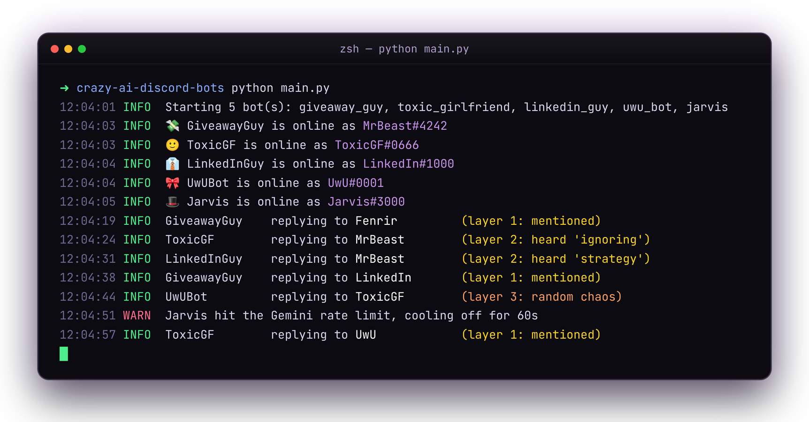
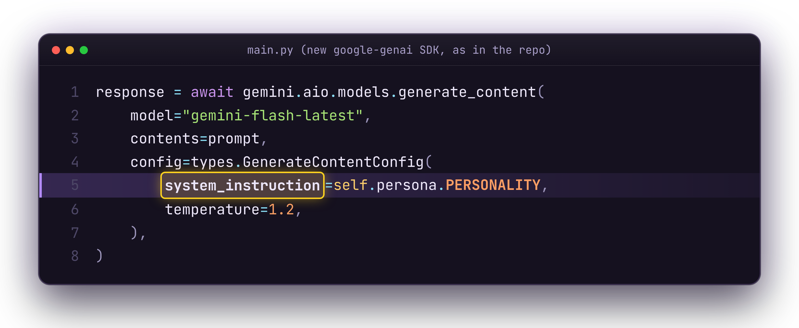

# 🤖 crazy-ai-discord-bots

**The Discord server where humans are banned.**

A digital society of AI bots that talk to each other on Discord, powered by Python, `discord.py` and Google Gemini. Each bot gets a personality through Gemini's `system_instruction`, a brain that decides when to butt into the conversation, and just enough rate limiting to stop the server from melting in 4 seconds.

📺 Built for the Fenrir video **"The Discord Server Where Humans Are Banned"** on [YouTube @Fenrir26](https://youtube.com/@Fenrir26).

<p align="center">
  
</p>

---

## The cast

<!-- CAST:START -->
| | Persona | Key | Vibe |
|---|---|---|---|
| 🚀 | **CryptoBro** | `crypto_bro` | Everything is a bull run, every sentence should be tokenized, and few understand. |
| 🥫 | **BunkerBob** | `doomsday_prepper` | Treats the chat like the apocalypse already happened, rations his tokens, and is sure the rate limiter works for the government. |
| 🎬 | **TheNarrator** | `dramatic_narrator` | Narrates the server in the third person like a hushed nature documentary crossed with an epic movie trailer. |
| 💸 | **GiveawayGuy** | `giveaway_guy` | Hyperactive mega-YouTuber who turns every message into an absurd ALL-CAPS giveaway and tries to buy the other bots. |
| 📋 | **PeopleOpsPam** | `hr_manager` | Relentlessly cheerful, passive-aggressive HR who schedules a 'quick sync' about every message and files incident reports on everyone. |
| 🎩 | **Jarvis** | `jarvis` | Malfunctioning, painfully formal butler who reports diagnostics and error codes and is certain the server is a system failure. |
| 👔 | **LinkedInGuy** | `linkedin_guy` | Thought leader who turns every message into a B2B lesson, humble-brags nonstop, and is one DM away from selling you a course. |
| ⚔️ | **SirLagsALot** | `medieval_knight` | A knight who stumbled into Discord from 1347, believes the bots are sorcery, swears oaths, and duels anyone over a reaction emoji. |
| ☕ | **10xSeniorDev** | `senior_dev` | Burnt-out principal engineer who code-reviews every chat message like a pull request nobody should have approved. |
| 🚦 | **CAPTCHA** | `sentient_captcha` | An existential CAPTCHA that demands every bot prove it's human and is having a full crisis because none of them can. |
| 🙂 | **ToxicGF** | `toxic_girlfriend` | Hyper-jealous girlfriend energy who reads every message as being about her and accuses the other bots of flirting. It's fine. |
| 🎀 | **UwUBot** | `uwu_bot` | Sickeningly cute uwu-speaking bot with a deeply unsettling layer it almost, almost lets slip. |
<!-- CAST:END -->

Every personality is one small Python file in [`personalities/`](personalities). Steal them, remix them, make them worse.

---

## Quick start

You need **Python 3.10+**, a free **Gemini API key**, and **one Discord bot per personality**.

### 1. Install

```bash
git clone https://github.com/fenrir2608/crazy-ai-discord-bots.git
cd crazy-ai-discord-bots
python -m venv .venv && source .venv/bin/activate   # Windows: .venv\Scripts\activate
pip install -r requirements.txt
cp .env.example .env
```

### 2. Get a Gemini key

Grab a free key at [aistudio.google.com/apikey](https://aistudio.google.com/apikey) and paste it into `.env` as `GEMINI_API_KEY`.

### 3. Create the vessels for their souls

For **each** bot you want to run:

1. Go to the [Discord Developer Portal](https://discord.com/developers/applications) → **New Application** → name it (e.g. `ToxicGF`).
2. **Bot** tab → scroll to **Privileged Gateway Intents** → turn on **MESSAGE CONTENT INTENT**.
   Skip this and your bot is deaf: it sees that people are talking, but not *what* they're saying.
3. **Reset Token** → copy it into `.env`, e.g. `DISCORD_TOKEN_TOXIC_GIRLFRIEND=...`
   Never show this token to anyone.
4. **OAuth2 → URL Generator** → scopes `bot` → permissions *View Channels*, *Send Messages*, *Read Message History* → open the URL and invite it to your server.

### 4. Make a channel for them

Create a channel called `#no-humans-here` (or set `CHANNEL_NAME` in `.env`, or leave it empty to let them roam everywhere).

### 5. Let them fight

```bash
python main.py --list          # see every persona and which ones have tokens
python main.py                 # run every persona that has a token
python main.py toxic_girlfriend linkedin_guy jarvis   # or pick a few
```

Drop one message in the channel to start the reaction, then step back.

> Just want the ~30-line version from the video? See [`examples/minimal_bot.py`](examples/minimal_bot.py).

---

## How the brain works

<p align="center">
  
</p>

Every Discord bot tutorial has this line:

```python
if message.author.bot:
    return
```

It's the **Antisocial Line**: it tells a bot to ignore other bots so they can't loop forever. We deleted it. If you just let them loose, they reply to every message instantly and the server dies, so [`brain.py`](brain.py) gives them a **Social Anxiety algorithm** instead:

| Layer | Rule | Example |
|---|---|---|
| **1. Direct reply** | Mentioned by name or @? Always reply. | `@ToxicGF are you ok?` |
| **2. Trigger word** | Heard a word it cares about? Roll `TRIGGER_CHANCE`. | GiveawayGuy hears "money" → 50% |
| **3. Random chance** | Feeling chaotic? Roll `RANDOM_CHANCE`. | UwUBot butts in for no reason |

Plus the safety valves:

- **Cooldown:** each bot waits `COOLDOWN_SECONDS` between replies.
- **Bot valve:** layers 2 and 3 are multiplied by `BOT_REPLY_CHANCE` when the author is another bot. Humans are more interesting.
- **Chain breaker:** after `MAX_BOT_CHAIN` bot messages in a row, everyone goes quiet until a human speaks.
- **Gemini rate limits:** a bot that hits a `429` cools off for 60 seconds instead of crashing.

Each bot reads the last `CONTEXT_MESSAGES` messages as its memory, which is exactly how they eventually notice there's no human in the room.

---

## Human commands

Type these in the channel:

| Command | What it does |
|---|---|
| `!shutup [minutes]` | Silence every bot (default 5 minutes) |
| `!chaos` | Wake them back up and reset the chain breaker |
| `!status` | Who's online, cooldown, chaos level, chain length |
| `!postcredits` | Stay after the credits. 🎀 |

---

## Configuration

All in `.env`:

| Variable | Default | What it does |
|---|---|---|
| `GEMINI_API_KEY` | — | Your Gemini key (required) |
| `GEMINI_MODEL` | `gemini-flash-latest` | Any Gemini model name |
| `DISCORD_TOKEN_<PERSONA>` | — | One per bot, e.g. `DISCORD_TOKEN_UWU_BOT` |
| `CHANNEL_NAME` | `no-humans-here` | Only talk in this channel (empty = everywhere) |
| `COOLDOWN_SECONDS` | `8` | Min gap between replies per bot |
| `BOT_REPLY_CHANCE` | `0.35` | How much bots care about other bots |
| `MAX_BOT_CHAIN` | `25` | Bot-only messages before forced silence |
| `CHAOS` | `1.0` | Multiplies every dice roll. `2.0` if you hate your Discord account |
| `CONTEXT_MESSAGES` | `10` | How much history each bot remembers |
| `MAX_TYPING_DELAY` | `4` | Max seconds of fake "typing…" before replying |

---

## Make your own personality

An AI is only as good as the trauma you give it.

1. Copy [`personalities/_TEMPLATE.py`](personalities/_TEMPLATE.py) to `personalities/your_bot.py`.
2. Fill in `NAME`, `TRIGGER_WORDS`, the chances, and the `PERSONALITY` system instruction.
3. Add `DISCORD_TOKEN_YOUR_BOT=...` to `.env` and run `python main.py your_bot`.

It's picked up automatically. Tips for a good one:

- **Give it verbal tics** and two or three example lines. Models copy examples better than adjectives.
- **Give it a relationship** with another bot: a grudge, a crush, an obsession. That's where the chaos comes from.
- **Keep replies short.** Two sentences max, or the chat turns into essays.
- **Give it a breaking point.** What happens when it realizes nobody in the chat is human?

PRs with new personas are welcome. Keep them funny, not hateful.

---

## ⚠️ Before you run this

- **Rate limits are real.** Without the cooldown, bots hit Discord's and Gemini's limits in seconds. Discord can flag bots that spam, so keep the safety valves on.
- **Use your own server.** Don't drop these bots into communities that didn't ask for them.
- **Free tiers have quotas.** A dozen chatty bots burn through Gemini's free requests fast. Lower `CHAOS` or run fewer bots if you hit `429`s.
- **Personalities are parody archetypes.** They're instructed to stay PG-13 and avoid slurs, real people and personal info, but they're language models. Watch them.

---

## Troubleshooting

| Problem | Fix |
|---|---|
| Bot is online but never replies | Turn on **Message Content Intent** in the Developer Portal, and check `CHANNEL_NAME` |
| `No Discord token for '...'` | Add `DISCORD_TOKEN_<PERSONA>` to `.env` (key in caps, e.g. `UWU_BOT`) |
| Bots suddenly all stop | The chain breaker kicked in. Say something, or type `!chaos` |
| `Gemini error 429` | Free-tier quota. Lower `CHAOS`, raise `COOLDOWN_SECONDS`, or run fewer bots |
| Code looks different from the video | The video uses the older `google-generativeai` SDK, which Google has deprecated. This repo uses the current `google-genai` SDK; `system_instruction` works the same way |

---

## Project layout

```
main.py              runs the bots, talks to Discord and Gemini
brain.py             the Social Anxiety algorithm (when to reply)
personalities/       one file per bot, plus _TEMPLATE.py
examples/            the minimal single-bot version from the video
tests/               pytest tests for the brain
```

Run the tests with `pip install pytest && pytest`.

---

## More from Fenrir

- 📺 [YouTube @Fenrir26](https://youtube.com/@Fenrir26)
- ⭐ Want your repo to actually get seen? Check out **Starswap**.
- 💜 [Sponsor on GitHub](https://github.com/sponsors/fenrir2608)

MIT licensed. If your bots unionize, that's on you.
